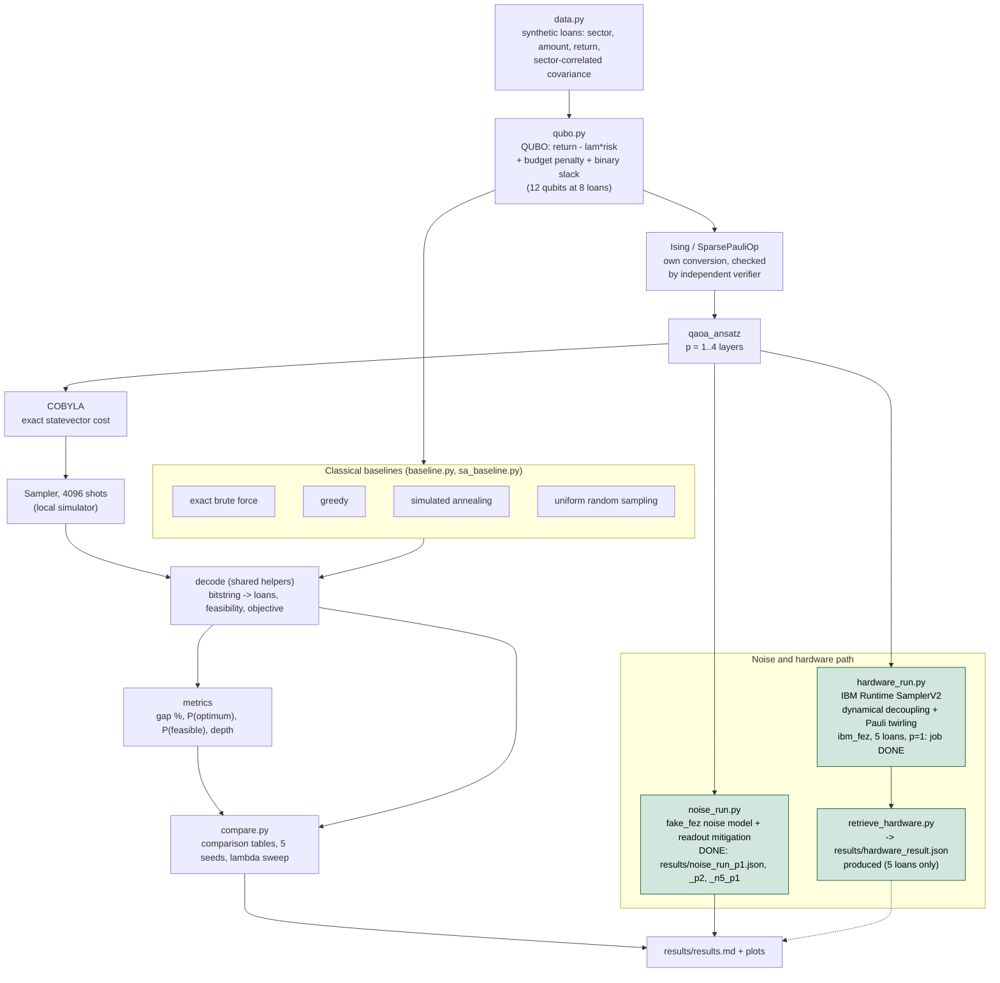
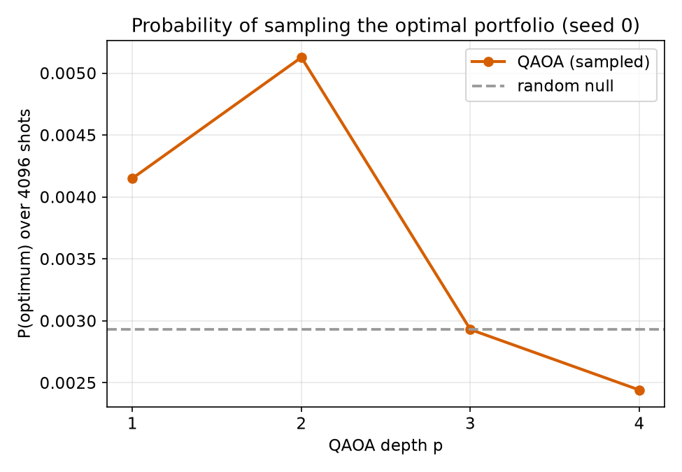
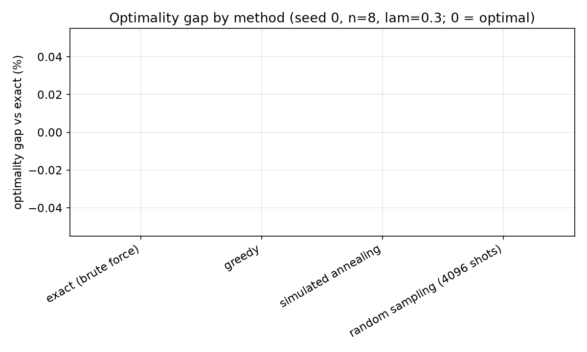

# QubitQuest: Microfinance Loan Portfolio Selection with QAOA

IBM Qiskit Fall Fest 2026, 48-Hour Quantum for Humanity Hackathon. Track: Financial Inclusion & Resilient Markets (Option B: microfinance portfolio via QUBO and QAOA).

**One-line pitch:** choose which small loans a microfinance lender should fund under a fixed budget, trading expected return against sector-correlated default risk, by encoding the problem as a QUBO and solving it with QAOA next to exact, greedy, simulated-annealing and random baselines. We report the comparison honestly and claim no quantum advantage.

## Team (TODO: fill in the remaining placeholders before submission)

- Team name: TODO
- Members:
  - Harsha (GitHub: HV66)
  - TODO: member 2 (name, GitHub)
  - TODO: member 3 (name, GitHub)
- Track: Finance (Financial Inclusion & Resilient Markets), Case Study 4, Option B (microfinance portfolio via QUBO and QAOA)
- Team lead: TODO

## Problem and beneficiary

Microfinance lenders serve low-income borrowers (smallholder farmers, market traders, small service businesses) who have little access to formal credit. A lender with a limited budget must decide which loan requests to fund. The choice is a trade-off between:

- **Reach and return:** funding more loans earns more interest and reaches more borrowers.
- **Risk:** borrowers in the same sector (for example farming) tend to default together after a shared shock such as a bad harvest, so a portfolio concentrated in one sector is fragile.

Beneficiaries are the borrowers who get funded and the lenders whose portfolios survive a sector shock. The model is a toy: it shows the formulation and method, not a deployable credit-scoring system.

**Demo video:** https://example.com/TODO-replace-with-video-url (placeholder, to be filled in by the team)

## Architecture



Source: `docs/architecture.mmd`.

## Approach

```
synthetic loans (data.py) -> QUBO with budget penalty (qubo.py) -> Ising Hamiltonian
  -> qaoa_ansatz (Qiskit) -> COBYLA on exact noiseless expectation -> sample 4096 shots
  -> decode loans, check feasibility, compare with classical baselines
```

- **Data:** seeded synthetic portfolio, 8 loans, integer amounts 1..8, three sectors, correlation 0.6 within a sector and 0.1 across sectors, budget = 40% of total requested amount.
- **QUBO:** minimise `-sum(ret_i x_i) + lam * risk(x) + P * (budget residual)^2`. Default `lam = 0.3`.
- **QAOA:** Ising Hamiltonian from the QUBO (own conversion, checked against brute force), Qiskit's `qaoa_ansatz` for p = 1..4 layers, COBYLA with restarts optimising the exact noiseless statevector expectation, then the optimised circuit is sampled with 4096 shots for the reported metrics.
- **Baselines:** exact brute force, greedy, simulated annealing, and a uniform random-sampling null (4096 random bitstrings).

## QUBO formulation and penalty proof summary

Variables: `x_i` in {0,1} (fund loan i) plus `m` slack bits that turn the budget inequality into an equality, with `m = bit_length(budget)`. For the default instance this gives 8 + 4 = 12 qubits (see `n_qubits` in `results/noise_run_p1.json`).

```
E(z) = - sum_i ret_i x_i
       + lam * sum_ij a_i a_j Sigma_ij x_i x_j
       + P * ( sum_i a_i x_i + sum_k c_k s_k - budget )^2
```

`a_i` is the loan amount, `Sigma` the loss covariance (sector-correlated), `c_k` the slack weights. The penalty weight is `P = sum(ret) + 1` (`qubo.auto_penalty`). Why this is enough:

1. `Sigma` is positive semidefinite, so the risk term is >= 0 and every state has energy >= `-sum(ret)`.
2. `x = 0` (no loans, slack equals budget) is feasible with energy 0, so the feasible optimum is <= 0.
3. Amounts, slack weights and budget are integers, so any violation has a nonzero integer residual `r` and a penalty `P * r^2 >= P`.
4. Hence any penalised state has energy >= `-sum(ret) + P = 1`, which is above the feasible optimum.

`P` is kept as small as the proof allows because a very large `P` flattens the useful part of the landscape. An independent verifier (`tests/independent/verify_independent.py`, report in `results/verifier_report.md`) recomputed the energies of all 2^(n+m) bitstrings with numpy and reported 28/28 checks passed, including that the minimum-energy state is feasible and optimal.

## How to run (Windows, PowerShell, from the repo root)

The full test suite takes about 2 to 5 minutes; `python demo.py` takes about 15 seconds.

```powershell
py -3.11 -m venv .venv
.venv\Scripts\python.exe -m pip install -r requirements.txt

# 1. tests
.venv\Scripts\python.exe -m pytest

# 2. live demo. Default: loads the saved best-p seed-0 parameters and samples
#    4096 shots (reproduces the headline row). --quick: REDUCED BUDGET, re-optimises
#    with fewer restarts/iterations/shots, so results differ.
.venv\Scripts\python.exe demo.py
.venv\Scripts\python.exe demo.py --quick

# 3. everything from scratch in one command (tests, lambda sweep, QAOA runs, compare, results.md)
.venv\Scripts\python.exe scripts\run_all.py

# or step by step
.venv\Scripts\python.exe qaoa_run.py --seeds 0 1 2 3 4 --ps 1 2 3
.venv\Scripts\python.exe compare.py
.venv\Scripts\python.exe compare.py --run-qaoa-lam
.venv\Scripts\python.exe scripts\make_results_md.py

# 4. noise-model simulation (fake_fez noise model, offline); writes results/noise_run_p{P}.json
.venv\Scripts\python.exe noise_run.py --p 1
.venv\Scripts\python.exe noise_run.py --p 2
.venv\Scripts\python.exe noise_run.py --n-loans 5 --p 1

# 5. real hardware (needs YOUR OWN IBM Quantum account; see note below)
.venv\Scripts\python.exe hardware_run.py --n-loans 5 --p 1 --dry-run
.venv\Scripts\python.exe hardware_run.py --n-loans 5 --p 1
.venv\Scripts\python.exe retrieve_hardware.py
```

Notes:

- Seeds are fixed everywhere. The seed-0 full run uses p = 1..4; seeds 1-4 use p = 1..3 (this is what is in `results/`).
- `hardware_run.py` needs an IBM Quantum account saved with `QiskitRuntimeService.save_account` (done by you, outside this repo) or the `QISKIT_IBM_TOKEN` environment variable. It never prints, stores or asks for a token. Without credentials it only prints the transpiled depth and two-qubit gate count for a generic fallback target and exits. It submits the job and returns immediately; `retrieve_hardware.py` fetches and scores it later and writes `results/hardware_result.json`.
- `hardware_run.py --n-loans 4|5` is the small-instance mode (same seeded data generator and code path). It prints the qubit count, transpiled depth and two-qubit gate count before anything is submitted.
- `scripts/run_all.py` deliberately does not call `hardware_run.py`.
- To regenerate the derived mean P(optimum) quoted below: load `sampling.p_optimal` from every `results/qaoa_seed*_p*.json` and average (one-off snippet, 16 files).

## Results

Source of truth: [`results/results.md`](results/results.md), generated by `scripts/make_results_md.py` from the JSON/CSV files in `results/`. Tables are copied below. Objective is minimised (lower is better); gap % = 100*(obj - exact)/|exact|.

### Main comparison (seed 0, n=8, lam=0.3, 4096 shots)

| method | objective (min) | value (max = -obj) | gap % | runtime s | logical depth | P(optimum) | P(feasible, decoded) |
|---|---|---|---|---|---|---|---|
| exact (brute force) | -3.1396 | 3.1396 | 0.0000 | 0.0061 | - | - | - |
| greedy | -3.1396 | 3.1396 | 0.0000 | 0.0006 | - | - | - |
| simulated annealing | -3.1396 | 3.1396 | 0.0000 | 0.1558 | - | - | - |
| random sampling (4096 shots) | -3.1396 | 3.1396 | 0.0000 | - | - | 0.0029 | 0.3662 |
| QAOA p=1 | -3.1396 | 3.1396 | 0.0000 | 5.8219 | 72 | 0.0042 | 0.7805 |
| QAOA p=2 | -3.1396 | 3.1396 | 0.0000 | 3.2051 | 114 | 0.0051 | 0.8833 |
| QAOA p=3 | -3.1396 | 3.1396 | 0.0000 | 3.1955 | 156 | 0.0029 | 0.8120 |
| QAOA p=4 | -3.1396 | 3.1396 | 0.0000 | 3.1052 | 198 | 0.0024 | 0.3960 |

### Lambda sensitivity (seed 0, QAOA at p=2)

| lam | method | objective (min) | gap % | P(optimum) |
|---|---|---|---|---|
| 0.1 | exact / greedy / simulated annealing | -3.3492 | 0.0000 | - |
| 0.1 | random sampling (4096 shots) | -3.3492 | 0.0000 | 0.0029 |
| 0.1 | QAOA p=2 | -3.3492 | 0.0000 | 0.0049 |
| 0.3 | exact / greedy / simulated annealing | -3.1396 | 0.0000 | - |
| 0.3 | random sampling (4096 shots) | -3.1396 | 0.0000 | 0.0029 |
| 0.3 | QAOA p=2 | -3.1396 | 0.0000 | 0.0051 |
| 1.0 | exact / greedy / simulated annealing | -2.4059 | 0.0000 | - |
| 1.0 | random sampling (4096 shots) | -2.4059 | 0.0000 | 0.0029 |
| 1.0 | QAOA p=2 | -2.4059 | 0.0000 | 0.0051 |

The full classical-only sweep over seeds 0-9 and lam in {0, 0.1, 0.3, 0.5, 1.0} is in `results/lambda_sweep.csv`. It shows the optimum changes with lam for some seeds (column `optimum_differs_from_lam0`), and greedy is suboptimal on some seeds (for example seed 2, lam 0.3: gap 15.3994%).

### Five-seed summary (lam = 0.3)

| method | seeds with gap | seeds missing | mean gap % | worst gap % |
|---|---|---|---|---|
| exact (brute force) | 5 | 0 | 0.0000 | 0.0000 |
| greedy | 5 | 0 | 3.0799 | 15.3994 |
| simulated annealing | 5 | 0 | 0.0000 | 0.0000 |
| random sampling (4096 shots) | 5 | 0 | 0.0000 | 0.0000 |
| QAOA p=1 | 5 | 0 | 0.0000 | 0.0000 |
| QAOA p=2 | 5 | 0 | 0.0000 | 0.0000 |
| QAOA p=3 | 5 | 0 | 0.0000 | 0.0000 |

Derived (one-off Python snippet over `sampling.p_optimal` in the 16 files `results/qaoa_seed*_p*.json`): QAOA P(optimum) ranges from 0.0020 to 0.0085 with mean 0.0047 over those 16 runs. For reference, uniform random sampling gives 0.0029 and picking one of 256 loan vectors uniformly gives 1/256 = 0.0039.

### What the optimiser's final <H> measures

The `final <H>` values in `results/results.md` (155.0201, 88.8962, 140.8156 and 610.6747 for p = 1 to 4) are the optimiser's exact expectation of the full QUBO energy, including the budget penalty and the constant offset, over the whole 12-qubit output distribution. They are not an objective value of a portfolio and they are not comparable with the optimal objective -3.1396. They sit far above it because:

- The QUBO energy spectrum of the seed-0 instance runs from -3.1396 to 6299.6068, with a uniform-state mean of 914.7001 (`results/spectrum_seed0.json`).
- Only 126 of the 4096 bitstrings have a zero budget residual (the penalty vanishes). Every other bitstring pays `P * residual^2` with P = 8.6439 and a residual up to 27 in absolute value, and the lowest energy among them is 5.4716.
- The QAOA state puts only 0.0981 / 0.1306 / 0.1078 / 0.0435 of its probability on zero-residual states (p = 1 to 4). Those states contribute about -0.11 to -0.15 to `<H>`; the violating states contribute the rest (155.1344, 89.0476, 140.9463 and 610.7327).

So `<H>` is dominated by probability mass on bitstrings that violate the budget equation, and it is the quantity COBYLA minimises. It does not track the sampled quality of the best decoded sample, which is why P(optimum) and the gap are reported separately. The normalised score (Emax - E)/(Emax - Emin) in `results/results.md` is a rescaling of the same `<H>`. Reproduce with `python -m scripts.spectrum_stats`.

### Plots






The live demo also writes `results/demo_plot.png`.

## Error mitigation and circuit depth

Two different depths appear in this repo and they are not comparable:

- **Logical depth (generic gates, all-to-all):** 72 / 114 / 156 / 198 for p = 1 / 2 / 3 / 4 (12 qubits, seed 0; the `depth` column of the main table, `qaoa_run.circuit_cost`). Basis {cx, rz, sx, x}, no coupling map, no routing. This is also what `demo.py` prints.
- **Transpiled depth on a backend coupling map:** for example 334 at p=1 and 655 at p=2 on `fake_fez` (12 qubits, `results/noise_run_p*.json`). Routing adds swaps and native-gate decomposition, so it is larger.

Transpiled depth on two different backends is also not identical: the 5-loan, p=1 circuit is depth 237 on the `fake_fez` noise-model target (`results/noise_run_n5_p1.json`) and depth 238 on the real `ibm_fez` backend (`results/hardware_result.json`). Both have 130 two-qubit gates. These are transpiled depth on the respective backend, not a contradiction.

**Noise-model simulation (`noise_run.py`):** the saved seed-0 parameters from `results/qaoa_seed0_p{P}.json` are run through an Aer noise model built from `fake_fez`, 4096 shots. Circuits are transpiled to that device's coupling map and basis. Full tables are in `results/results.md`; the files are `results/noise_run_p1.json`, `results/noise_run_p2.json` and `results/noise_run_n5_p1.json`.

| instance | p | transpiled depth on fake_fez | two-qubit gates | noiseless P(optimum) | noisy P(optimum) | noisy + readout mitigation P(optimum) |
|---|---|---|---|---|---|---|
| 8 loans, 12 qubits | 1 | 334 | 223 | 0.0054 | 0.0029 | 0.0022 |
| 8 loans, 12 qubits | 2 | 655 | 519 | 0.0042 | 0.0034 | 0.0037 |
| 5 loans, 9 qubits | 1 | 237 | 130 | 0.0500 | 0.0420 | 0.0464 |

Honest reading: noise lowers P(optimum) in all three rows. Readout mitigation lowered it at p=1 on 12 qubits and raised it slightly in the other two rows; with 4096 shots these differences are tens of hits, so we do not claim mitigation helps. The only mitigation applied in simulation is a tensored per-qubit readout calibration; no ZNE, dynamical decoupling or twirling is applied there (the Aer noise model has no idle dephasing for DD to act on). The p=2 circuit on 12 qubits needs 519 two-qubit gates after routing, which is above the 300-gate limit `hardware_run.py` uses to decide a circuit is unrealistic for current hardware, so a 12-qubit hardware run would not be attempted at p=2.

**Real hardware (`ibm_fez`, 5 loans, p=1).** A real-backend job was submitted and its counts were retrieved with `retrieve_hardware.py`: job id `dc3imv5hdvas73bo063g`, status DONE on IBM Quantum (re-checked with `retrieve_hardware.py`), submitted 2026-11-25 18:39:55 UTC (`results/hardware_job.json`, `results/hardware_result.json`). Instance: seed 0, 5 loans, 9 qubits, parameters from `results/hardware_params_seed0_n5_p1.json`; transpiled depth 238 with 130 two-qubit gates on `ibm_fez` (optimization level 3); SamplerV2 with dynamical decoupling (XpXm) and Pauli twirling. **Shots: 4096.** The job was submitted with 4096 shots, and the saved counts sum to 4096.

| 5 loans, p=1, 4096 shots | P(optimum) | P(feasible, decoded) | P(raw feasible, zero penalty) | best-sample gap % |
|---|---|---|---|---|
| noise model, noiseless (fake_fez target) | 0.0500 | 0.7788 | 0.1118 | 0.0000 |
| noise model, noisy | 0.0420 | 0.7332 | 0.0916 | 0.0000 |
| **real `ibm_fez`** | **0.0405** | **0.6692** | **0.0818** | 0.0000 |
| uniform random sampling (same 4096 shots, 5 loans) | 0.0271 | 0.4119 | 0.0369 | n/a |

Reading: the hardware P(optimum) of 0.0405 is 166 optimum hits out of 4096; uniform random sampling expects 1/32 = 128 hits. The exact one-sided binomial test used elsewhere in this README (alpha 0.05) calls that above random (p-value 0.0006), on one run, one instance and one seed, with no mitigation comparison on hardware. It is close to the noisy simulation (0.0420), slightly below the noiseless one (0.0500), and it is not evidence of quantum advantage: at 5 loans the search space has 32 loan vectors and the classical baselines solve it exactly. The best-sample gap is 0% because the 4096 shots cover all 32 loan vectors (`distinct_loan_vectors` is 32 in `results/hardware_result.json`), so it is uninformative here too. Depth 237 versus 238 above is the same circuit transpiled for two different backends.

Other instance sizes were not run on hardware. The 12-qubit instance transpiles to 223 two-qubit gates at p=1 and 519 at p=2 on the `fake_fez` coupling map, above the 300-gate limit `hardware_run.py` uses to flag a circuit as unrealistic. The hardware run used real credentials supplied by the user outside the repo; no token is stored in the repo.

## Honest limitations

- **No quantum advantage is claimed or measured.** At n = 8 every classical method reaches the exact optimum on the headline instance: exact, greedy (on seed 0), and simulated annealing all give gap 0.0000%. Greedy is suboptimal on some seeds (five-seed mean gap 3.0799%, worst 15.3994%); simulated annealing is not.
- **The 0% gap column for QAOA and random sampling is uninformative.** It is a best-of-4096-shots statistic over a 256-vector search space (all 16 QAOA runs and all 16 random runs report a 0.0% gap). **P(optimum) is the honest metric.** Across the 16 QAOA runs (seed 0 p=1..4, seeds 1-4 p=1..3), an exact one-sided binomial test of QAOA's optimum hits against the uniform-random rate 1/256 at alpha 0.05 gives: 5 runs above random, 10 indistinguishable from random, 1 below random (`results/compare_vs_random.csv`, per-row table in `results/results.md`). The above-random runs are seed 1 p=1, seed 1 p=3, seed 2 p=1, seed 2 p=3 and seed 3 p=2; the below-random run is seed 2 p=2. At seed 0, the headline instance, all four depths are indistinguishable from random. With 16 tests, about 0.8 false 'above random' verdicts are expected by chance, so 5 is more than chance alone, but it is a small effect: mean QAOA P(optimum) is 0.0047 against a mean random value of 0.0034 (both computed from the 16 result files).
- QAOA does raise the probability that a decoded sample is budget-feasible: 0.3960 to 0.8833 across the 16 runs against 0.3145 to 0.3662 for random sampling at the same shots. The seed-0 p=4 run is the low end (0.3960), so this is not a clean trend with depth.
- 12 qubits are trivial to simulate classically; this is a feasibility demonstration, not a scaling result.
- **Honest metrics.** With 12 qubits there are 4096 basis states, and each QAOA run is sampled 4096 times. The sampled runs cover 201 to 256 of the 256 loan vectors (`distinct_loan_vectors` in `results/qaoa_seed*_p*.json`), so a best-sample gap is close to exhaustive search and a 0% gap is weak evidence. The meaningful metric is P(optimum) against random sampling at the same shots (table above): 5 of 16 runs above random, 10 indistinguishable, 1 below.
- **Feasibility finding.** On the `fake_fez` coupling map the 12-qubit circuit transpiles to depth 334 with 223 two-qubit gates at p=1, and depth 655 with 519 two-qubit gates at p=2 (`results/noise_run_p1.json`, `results/noise_run_p2.json`). The p=2 count is above the 300 two-qubit-gate limit `hardware_run.py` uses to call a circuit unrealistic for current hardware.
- The optimiser's "normalised score" is (Emax - E)/(Emax - Emin) over the QUBO spectrum, not a multiplicative approximation ratio; see `results/results.md`.
- The penalty term makes the energy landscape rough, which is hard for QAOA with a local optimiser such as COBYLA.
- The optimiser's inner loop uses the **exact noiseless expectation**, computed by our own numpy statevector simulator (`qaoa_run.fast_probabilities`), not by Qiskit. It is verified against the Qiskit `QAOAAnsatz` statevector for p = 1, 2, 3 and 4 in `tests/test_qaoa.py` (4-loan instance). On hardware the expectation would be estimated from shots; this is a simulation-only shortcut. The final metrics do come from sampling.
- Final sampling uses `qiskit.primitives.StatevectorSampler`, the primitives-V2 reference sampler (exact simulation, seeded shot noise), on the circuit transpiled to a generic basis.
- `demo.py` by default loads the saved seed-0 best-p parameters (the lowest stored optimiser objective) and samples the saved circuit with 4096 shots through `qaoa_run.sample_counts`, the same path as the full runs. `demo.py --quick` re-optimises with fewer restarts, iterations and shots, prints a REDUCED BUDGET banner, and its numbers differ from `results/results.md`.
- Data is synthetic with a simple sector-correlation model; it is not calibrated to real loan books.
- Only 5 seeds and one simulated instance size; one real-hardware run (5 loans, p=1, one job) and no hardware error-mitigation comparison.

## Verification

Independent review: `results/codex_review.md` (reviewer: Codex). The reviewer confirmed the QUBO-to-Ising energies (an independent enumeration of all 256 bitstrings of a 4-loan instance, plus our own all-bitstring test on five 8-loan instances) and that the numpy simulator matches the Qiskit `QAOAAnsatz` probabilities for p=1 to 4. Its three findings and their status:

| finding | status |
|---|---|
| P3: README described a demo sampling path the code does not use (it said a numpy sampler) | Fixed: README now states that `demo.py` samples through `qaoa_run.sample_counts` |
| P3: a zero optimum forced the best-feasible gap to 0.0% even for a suboptimal sample | Fixed: `qaoa_run.gap_percent` returns 0.0 only on an exact match and `None` otherwise (tested) |
| P2: `P(optimum)` counts only the single reference optimal vector, so tied optima would be undercounted | Guarded by a test: `tests/test_qaoa.py::test_unique_optimum_for_published_instances` asserts a unique optimum for seeds 0-4 (the published instances); the metric is not changed for tied optima |

Other checks: an independent verifier (`tests/independent/verify_independent.py`, report in `results/verifier_report.md`) re-derives the QUBO energies and the constrained optimum from the problem definition without importing our objective or Ising code; it does not cover the QAOA circuit, sampling or metrics.

## Next steps

- Repeat the real-hardware run with more seeds and with and without dynamical decoupling and twirling, to separate the effect of mitigation from run-to-run variation.
- Larger instances (n beyond what brute force handles) with a fair, matched-budget comparison against simulated annealing.
- Shot-based expectation estimation in the optimiser loop, and warm-started or layer-wise parameter initialisation.
- Mixers or encodings that respect the budget constraint to avoid the penalty term and the slack qubits.
- Real, anonymised sector default data and a sector-shock stress test.

## Pinned versions

From `requirements.txt` (Python 3.11):

```
qiskit==2.6.2
qiskit-aer==0.18.4
qiskit-ibm-runtime==0.52.1
numpy==2.4.6
scipy==1.17.1
matplotlib==3.11.2
pytest==9.2.0
ruff==0.17.6
black==26.10.1
```

## Credits

All open source:

- [Qiskit](https://github.com/Qiskit/qiskit) 2.6.2 (circuits, `QAOAAnsatz`, transpiler, primitives)
- [qiskit-aer](https://github.com/Qiskit/qiskit-aer) 0.18.4 (simulation and noise model)
- [qiskit-ibm-runtime](https://github.com/Qiskit/qiskit-ibm-runtime) 0.52.1 (`fake_fez` fake backend, SamplerV2, hardware access)
- [NumPy](https://numpy.org) 2.4.6, [SciPy](https://scipy.org) 1.17.1 (COBYLA)
- [Matplotlib](https://matplotlib.org) 3.11.2 (plots)
- [pytest](https://pytest.org) 9.2.0, [Ruff](https://github.com/astral-sh/ruff) 0.17.6, [Black](https://github.com/psf/black) 26.10.1 (tests, lint, format)

## Data statement

All data is synthetic, generated from a seed by `data.py`. No real borrower, customer, patient or confidential data is used.

## AI-assistance disclosure

Built with Claude Code, Codex and IBM Bob; problem formulation, verification and results reviewed by the team.

## Licence

Apache-2.0. See [LICENSE](LICENSE).
