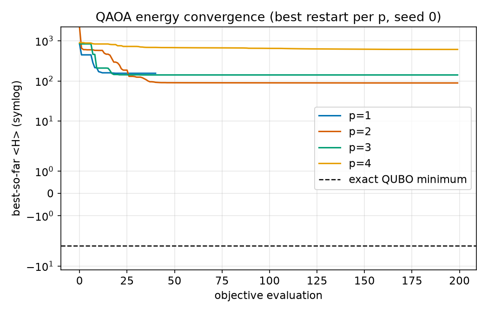

# QubitQuest: Microfinance Loan Portfolio Selection with QAOA

IBM Qiskit Fall Fest 2026, 48-Hour Quantum for Humanity Hackathon. Track: Financial Inclusion & Resilient Markets (Option B: microfinance portfolio via QUBO and QAOA).

**One-line pitch:** choose which small loans a microfinance lender should fund under a fixed budget, trading expected return against sector-correlated default risk, by encoding the problem as a QUBO and solving it with QAOA next to exact, greedy, simulated-annealing and random baselines. We report the comparison honestly and claim no quantum advantage.

## Team (TODO: fill in before submission)

- Team name: TODO
- Members: TODO
- Track: Financial Inclusion & Resilient Markets
- Team lead: TODO

## Problem and beneficiary

Microfinance lenders serve low-income borrowers (smallholder farmers, market traders, small service businesses) who have little access to formal credit. A lender with a limited budget must decide which loan requests to fund. The choice is a trade-off between:

- **Reach and return:** funding more loans earns more interest and reaches more borrowers.
- **Risk:** borrowers in the same sector (for example farming) tend to default together after a shared shock such as a bad harvest, so a portfolio concentrated in one sector is fragile.

Beneficiaries are the borrowers who get funded and the lenders whose portfolios survive a sector shock. The model is a toy: it shows the formulation and method, not a deployable credit-scoring system.

## Approach

```
synthetic loans (data.py) -> QUBO with budget penalty (qubo.py) -> Ising Hamiltonian
  -> QAOAAnsatz (Qiskit) -> COBYLA on exact noiseless expectation -> sample 4096 shots
  -> decode loans, check feasibility, compare with classical baselines
```

- **Data:** seeded synthetic portfolio, 8 loans, integer amounts 1..8, three sectors, correlation 0.6 within a sector and 0.1 across sectors, budget = 40% of total requested amount.
- **QUBO:** minimise `-sum(ret_i x_i) + lam * risk(x) + P * (budget residual)^2`. Default `lam = 0.3`.
- **QAOA:** Ising Hamiltonian from the QUBO (own conversion, checked against brute force), `QAOAAnsatz` for p = 1..4 layers, COBYLA with restarts optimising the exact noiseless statevector expectation, then the optimised circuit is sampled with 4096 shots for the reported metrics.
- **Baselines:** exact brute force, greedy, simulated annealing, and a uniform random-sampling null (4096 random bitstrings).

## QUBO formulation and penalty proof summary

Variables: `x_i` in {0,1} (fund loan i) plus `m` slack bits that turn the budget inequality into an equality, with `m = bit_length(budget)`. For the default instance this gives 8 + 4 = 12 qubits (see `n_qubits` in `results/noise_run.json`).

```
E(z) = - sum_i ret_i x_i
       + lam * sum_ij a_i a_j Sigma_ij x_i x_j
       + P * ( sum_i a_i x_i + sum_k c_k s_k - budget )^2
```

`a_i` is the loan amount, `Sigma` the loss covariance (sector-correlated), `c_k` the slack weights. The penalty weight is `P = sum(ret) + 1` (`qubo.auto_penalty`). Why this is enough:

1. `Sigma` is positive semidefinite, so the risk term is >= 0 and every state has energy >= `-sum(ret)`.
2. `x = 0` (no loans, slack equals budget) is feasible with energy 0, so the feasible optimum is <= 0.
3. Amounts, slack weights and budget are integers, so any violation has a nonzero integer residual `r` and a penalty `P * r^2 >= P`.
4. Hence any penalised state has energy >= `-sum(ret) + P = 1`, which is above the feasible optimum.

`P` is kept as small as the proof allows because a very large `P` flattens the useful part of the landscape. An independent verifier (`tests/independent/verify_independent.py`, report in `results/verifier_report.md`) recomputed the energies of all 2^(n+m) bitstrings with numpy and reported 28/28 checks passed, including that the minimum-energy state is feasible and optimal.

## How to run (Windows, PowerShell, from the repo root)

```powershell
py -3.11 -m venv .venv
.venv\Scripts\python.exe -m pip install -r requirements.txt

# 1. tests
.venv\Scripts\python.exe -m pytest

# 2. quick live demo (a few seconds, reduced budget) or the default demo
.venv\Scripts\python.exe demo.py --quick
.venv\Scripts\python.exe demo.py

# 3. everything from scratch in one command (tests, lambda sweep, QAOA runs, compare, results.md)
.venv\Scripts\python.exe scripts\run_all.py

# or step by step
.venv\Scripts\python.exe qaoa_run.py --seeds 0 1 2 3 4 --ps 1 2 3
.venv\Scripts\python.exe compare.py
.venv\Scripts\python.exe compare.py --run-qaoa-lam
.venv\Scripts\python.exe scripts\make_results_md.py

# 4. noise-model simulation (fake_fez noise model, offline)
.venv\Scripts\python.exe noise_run.py

# 5. real hardware (needs YOUR OWN IBM Quantum account; see note below)
.venv\Scripts\python.exe hardware_run.py --dry-run
.venv\Scripts\python.exe hardware_run.py
.venv\Scripts\python.exe retrieve_hardware.py
```

Notes:

- Seeds are fixed everywhere. The seed-0 full run uses p = 1..4; seeds 1-4 use p = 1..3 (this is what is in `results/`).
- `hardware_run.py` needs an IBM Quantum account saved with `QiskitRuntimeService.save_account` (done by you, outside this repo) or the `QISKIT_IBM_TOKEN` environment variable. It never prints, stores or asks for a token. Without credentials it only prints the transpiled depth and two-qubit gate count for a generic fallback target and exits. It submits the job and returns immediately; `retrieve_hardware.py` fetches and scores it later and writes `results/hardware_result.json`.
- `scripts/run_all.py` deliberately does not call `hardware_run.py`.
- To regenerate the derived mean P(optimum) quoted below: load `sampling.p_optimal` from every `results/qaoa_seed*_p*.json` and average (one-off snippet, 16 files).

## Results

Source of truth: [`results/results.md`](results/results.md), generated by `scripts/make_results_md.py` from the JSON/CSV files in `results/`. Tables are copied below. Objective is minimised (lower is better); gap % = 100*(obj - exact)/|exact|.

### Main comparison (seed 0, n=8, lam=0.3, 4096 shots)

| method | objective (min) | value (max = -obj) | gap % | runtime s | depth | P(optimum) | P(feasible, decoded) |
|---|---|---|---|---|---|---|---|
| exact (brute force) | -3.1396 | 3.1396 | 0.0000 | 0.0034 | - | - | - |
| greedy | -3.1396 | 3.1396 | 0.0000 | 0.0004 | - | - | - |
| simulated annealing | -3.1396 | 3.1396 | 0.0000 | 0.1250 | - | - | - |
| random sampling (4096 shots) | -3.1396 | 3.1396 | 0.0000 | - | - | 0.0029 | 0.3662 |
| QAOA p=1 | -3.1396 | 3.1396 | 0.0000 | 5.8219 | 72 | 0.0042 | 0.7805 |
| QAOA p=2 | -3.1396 | 3.1396 | 0.0000 | 3.2051 | 114 | 0.0051 | 0.8833 |
| QAOA p=3 | -3.1396 | 3.1396 | 0.0000 | 3.1955 | 156 | 0.0029 | 0.8120 |
| QAOA p=4 | -3.1396 | 3.1396 | 0.0000 | 3.1052 | 198 | 0.0024 | 0.3960 |

### Lambda sensitivity (seed 0, QAOA at p=2)

| lam | method | objective (min) | gap % | P(optimum) |
|---|---|---|---|---|
| 0.1 | exact / greedy / simulated annealing | -3.3492 | 0.0000 | - |
| 0.1 | random sampling (4096 shots) | -3.3492 | 0.0000 | 0.0029 |
| 0.1 | QAOA p=2 | -3.3492 | 0.0000 | 0.0049 |
| 0.3 | exact / greedy / simulated annealing | -3.1396 | 0.0000 | - |
| 0.3 | random sampling (4096 shots) | -3.1396 | 0.0000 | 0.0029 |
| 0.3 | QAOA p=2 | -3.1396 | 0.0000 | 0.0051 |
| 1.0 | exact / greedy / simulated annealing | -2.4059 | 0.0000 | - |
| 1.0 | random sampling (4096 shots) | -2.4059 | 0.0000 | 0.0029 |
| 1.0 | QAOA p=2 | -2.4059 | 0.0000 | 0.0051 |

The full classical-only sweep over seeds 0-9 and lam in {0, 0.1, 0.3, 0.5, 1.0} is in `results/lambda_sweep.csv`. It shows the optimum changes with lam for some seeds (column `optimum_differs_from_lam0`), and greedy is suboptimal on some seeds (for example seed 2, lam 0.3: gap 15.3994%).

### Five-seed summary (lam = 0.3)

| method | seeds with gap | seeds missing | mean gap % | worst gap % |
|---|---|---|---|---|
| exact (brute force) | 5 | 0 | 0.0000 | 0.0000 |
| greedy | 5 | 0 | 3.0799 | 15.3994 |
| simulated annealing | 5 | 0 | 0.0000 | 0.0000 |
| random sampling (4096 shots) | 5 | 0 | 0.0000 | 0.0000 |
| QAOA p=1 | 5 | 0 | 0.0000 | 0.0000 |
| QAOA p=2 | 5 | 0 | 0.0000 | 0.0000 |
| QAOA p=3 | 5 | 0 | 0.0000 | 0.0000 |

Derived (one-off Python snippet over `sampling.p_optimal` in the 16 files `results/qaoa_seed*_p*.json`): QAOA P(optimum) ranges from 0.0020 to 0.0085 with mean 0.0047 over those 16 runs. For reference, uniform random sampling gives 0.0029 and picking one of 256 loan vectors uniformly gives 1/256 = 0.0039.

### Plots




The live demo also writes `results/demo_plot.png`.

## Error mitigation and circuit depth

**Circuit depth (transpiled, generic basis, all-to-all connectivity):** 72 / 114 / 156 / 198 for p = 1 / 2 / 3 / 4 (12 qubits, seed 0; from the main table).

**Noise-model simulation (`noise_run.py`, `results/noise_run.json`):** same optimised p=1 circuit, 12 qubits, 4096 shots, Aer noise model from `fake_fez`. Transpiled to that device's coupling map and basis: depth 334, 223 two-qubit gates.

| variant | P(optimum) | P(feasible, decoded) |
|---|---|---|
| noiseless | 0.0054 | 0.7915 |
| noisy (fake_fez) | 0.0029 | 0.7087 |
| noisy + tensored readout mitigation | 0.0022 | 0.7009 |

Honest reading: the noise model lowers both metrics, and **readout mitigation did not help** (both numbers are slightly lower than the unmitigated noisy run; the differences are small relative to sampling noise at 4096 shots). The only mitigation applied in simulation is a tensored per-qubit readout calibration; no ZNE, dynamical decoupling or twirling is applied there (the Aer noise model has no idle dephasing for DD to act on).

**Real hardware: NOT RUN.** `results/hardware_result.json` does not exist. `hardware_run.py` is configured with dynamical decoupling and Pauli twirling (SamplerV2 options, verified against qiskit-ibm-runtime 0.52.1) and falls back to smaller instances (5 then 4 loans) if the routed depth or two-qubit count is too large, but no job has been submitted or retrieved, so this repo contains no real-hardware results. Parameter files for the planned runs are in `results/hardware_params_*.json`.

## Honest limitations

- **No quantum advantage is claimed or measured.** At n = 8 every classical method reaches the exact optimum on the headline instance: exact, greedy (on seed 0), and simulated annealing all give gap 0.0000%. Greedy is suboptimal on some seeds (five-seed mean gap 3.0799%, worst 15.3994%); simulated annealing is not.
- **The 0% gap column for QAOA and random sampling is uninformative.** It is a best-of-4096-shots statistic over a 256-vector search space, so any method that samples enough reaches the optimum. **P(optimum) is the honest metric**, and QAOA's 0.20% to 0.85% (mean 0.47% over 16 runs) is statistically close to uniform random (0.29%) and to 1/256 = 0.39%. With 4096 shots these are only tens of hits, so differences of this size are close to sampling noise. QAOA does raise the probability of a decoded-feasible sample (about 0.78 to 0.88 vs 0.37 for random at p=1..3 on seed 0), but p=4 drops back to 0.40, so this is not a clean trend.
- 12 qubits are trivial to simulate classically; this is a feasibility demonstration, not a scaling result.
- The penalty term makes the energy landscape rough, which is hard for QAOA with a local optimiser such as COBYLA.
- The optimiser's inner loop uses the **exact noiseless expectation**. On hardware the expectation would be estimated from shots; this is a simulation-only shortcut. The final metrics do come from sampling.
- The live demo uses a reduced budget (fewer restarts, iterations and shots) and samples with a numpy helper rather than `StatevectorSampler`; full-budget numbers are in `results/results.md`.
- Data is synthetic with a simple sector-correlation model; it is not calibrated to real loan books.
- Only 5 seeds, one instance size, no real-hardware run.

## Next steps

- Run the configured job on real IBM hardware (smallest feasible instance first) and report P(optimum) against the noise-model prediction.
- Larger instances (n beyond what brute force handles) with a fair, matched-budget comparison against simulated annealing.
- Shot-based expectation estimation in the optimiser loop, and warm-started or layer-wise parameter initialisation.
- Mixers or encodings that respect the budget constraint to avoid the penalty term and the slack qubits.
- Real, anonymised sector default data and a sector-shock stress test.

## Pinned versions

From `requirements.txt` (Python 3.11):

```
qiskit==2.6.2
qiskit-aer==0.18.4
qiskit-ibm-runtime==0.52.1
numpy==2.4.6
scipy==1.17.1
matplotlib==3.11.2
pytest==9.2.0
ruff==0.17.6
black==26.10.1
```

## Credits

All open source:

- [Qiskit](https://github.com/Qiskit/qiskit) 2.6.2 (circuits, `QAOAAnsatz`, transpiler, primitives)
- [qiskit-aer](https://github.com/Qiskit/qiskit-aer) 0.18.4 (simulation and noise model)
- [qiskit-ibm-runtime](https://github.com/Qiskit/qiskit-ibm-runtime) 0.52.1 (`fake_fez` fake backend, SamplerV2, hardware access)
- [NumPy](https://numpy.org) 2.4.6, [SciPy](https://scipy.org) 1.17.1 (COBYLA)
- [Matplotlib](https://matplotlib.org) 3.11.2 (plots)
- [pytest](https://pytest.org) 9.2.0, [Ruff](https://github.com/astral-sh/ruff) 0.17.6, [Black](https://github.com/psf/black) 26.10.1 (tests, lint, format)

## Data statement

All data is synthetic, generated from a seed by `data.py`. No real borrower, customer, patient or confidential data is used.

## AI-assistance disclosure

Built with Claude Code, Codex and IBM Bob; problem formulation, verification and results reviewed by the team.

## Licence

Apache-2.0. See [LICENSE](LICENSE).
