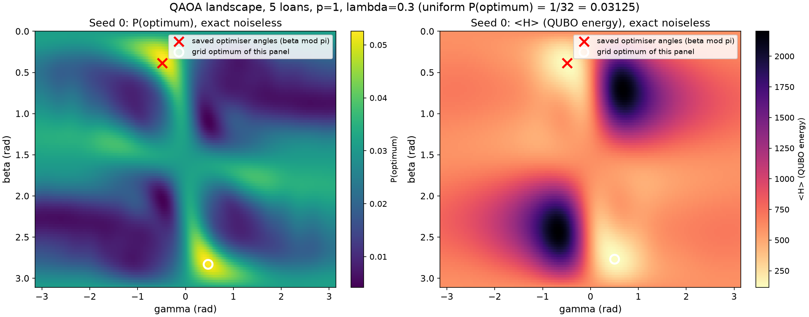
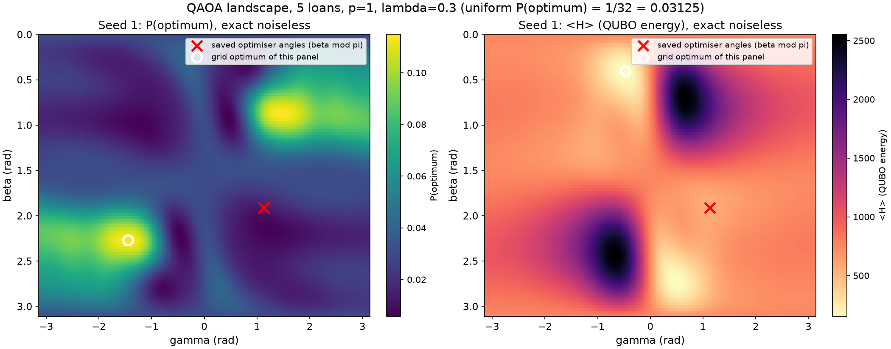

# Results

Generated by `scripts/make_results_md.py` from `results/compare_main.json` and related result files. Objective is minimised (lower is better); gap % = 100*(obj-exact)/|exact|.

## Main comparison (seed 0, n=8, lam=0.3, 4096 shots)

| method | objective (min) | value (max = -obj) | gap % | runtime s | logical depth | P(optimum) | P(feasible, decoded) | note |
|---|---|---|---|---|---|---|---|---|
| exact (brute force) | -3.1396 | 3.1396 | 0.0000 | 0.0061 | - | - | - |  |
| greedy | -3.1396 | 3.1396 | 0.0000 | 0.0006 | - | - | - |  |
| simulated annealing | -3.1396 | 3.1396 | 0.0000 | 0.1558 | - | - | - |  |
| random sampling (4096 shots) | -3.1396 | 3.1396 | 0.0000 | - | - | 0.0029 | 0.3662 |  |
| QAOA p=1 | -3.1396 | 3.1396 | 0.0000 | 5.8219 | 72 | 0.0042 | 0.7805 |  |
| QAOA p=2 | -3.1396 | 3.1396 | 0.0000 | 3.2051 | 114 | 0.0051 | 0.8833 |  |
| QAOA p=3 | -3.1396 | 3.1396 | 0.0000 | 3.1955 | 156 | 0.0029 | 0.8120 |  |
| QAOA p=4 | -3.1396 | 3.1396 | 0.0000 | 3.1052 | 198 | 0.0024 | 0.3960 |  |

## Reading the results

Seed 0, n=8, lam=0.3. exact (brute force): gap 0.00%; greedy: gap 0.00%; simulated annealing: gap 0.00%; random sampling (4096 shots): gap 0.00%. Best QAOA: gap 0.00% (QAOA p=1). greedy ties the best QAOA by gap. simulated annealing ties the best QAOA by gap. random sampling (4096 shots) ties the best QAOA by gap. Highest QAOA P(optimum) is 0.0051 (QAOA p=2) vs 0.0029 for uniform random sampling; picking one of the 256 loan vectors uniformly gives 0.0039. With 4096 shots these P(optimum) values are only a few dozen hits, so differences of this size are close to sampling noise. The gap column is best-of-shots over a small search space, so every method that samples enough reaches 0%; P(optimum) is the more informative column. Classical solvers at this size are exact or near-exact in well under a second; no quantum advantage is claimed.

## Lambda sensitivity (seed 0)

QAOA at a single depth p=2.

| lam | method | objective (min) | gap % | P(optimum) | note |
|---|---|---|---|---|---|
| 0.1000 | exact (brute force) | -3.3492 | 0.0000 | - |  |
| 0.1000 | greedy | -3.3492 | 0.0000 | - |  |
| 0.1000 | simulated annealing | -3.3492 | 0.0000 | - |  |
| 0.1000 | random sampling (4096 shots) | -3.3492 | 0.0000 | 0.0029 |  |
| 0.1000 | QAOA p=2 | -3.3492 | 0.0000 | 0.0049 |  |
| 0.3000 | exact (brute force) | -3.1396 | 0.0000 | - |  |
| 0.3000 | greedy | -3.1396 | 0.0000 | - |  |
| 0.3000 | simulated annealing | -3.1396 | 0.0000 | - |  |
| 0.3000 | random sampling (4096 shots) | -3.1396 | 0.0000 | 0.0029 |  |
| 0.3000 | QAOA p=2 | -3.1396 | 0.0000 | 0.0051 |  |
| 1.0000 | exact (brute force) | -2.4059 | 0.0000 | - |  |
| 1.0000 | greedy | -2.4059 | 0.0000 | - |  |
| 1.0000 | simulated annealing | -2.4059 | 0.0000 | - |  |
| 1.0000 | random sampling (4096 shots) | -2.4059 | 0.0000 | 0.0029 |  |
| 1.0000 | QAOA p=2 | -2.4059 | 0.0000 | 0.0051 |  |

## Five-seed summary (lam=0.3)

| method | seeds with gap | seeds missing | mean gap % | worst gap % |
|---|---|---|---|---|
| exact (brute force) | 5 | 0 | 0.0000 | 0.0000 |
| greedy | 5 | 0 | 3.0799 | 15.3994 |
| simulated annealing | 5 | 0 | 0.0000 | 0.0000 |
| random sampling (4096 shots) | 5 | 0 | 0.0000 | 0.0000 |
| QAOA p=1 | 5 | 0 | 0.0000 | 0.0000 |
| QAOA p=2 | 5 | 0 | 0.0000 | 0.0000 |
| QAOA p=3 | 5 | 0 | 0.0000 | 0.0000 |

## Optimiser normalised score (seed 0)

Normalised score = (Emax - E) / (Emax - Emin), where E is the optimiser's final exact <H> and Emin, Emax are the smallest and largest QUBO energies over all bitstrings. It is 1 at the QUBO minimum and 0 at the maximum. It is NOT a multiplicative approximation ratio. It is a measure of the optimiser's expectation value, not of sampled solution quality; the sampled metrics are P(optimum) and the best-feasible gap above.

| p | final <H> | normalised score | score of the uniform state |
|---|---|---|---|
| 1 | 155.0201 | 0.9749 | 0.8544 |
| 2 | 88.8962 | 0.9854 | 0.8544 |
| 3 | 140.8156 | 0.9772 | 0.8544 |
| 4 | 610.6747 | 0.9026 | 0.8544 |

## QAOA vs random sampling, every seed and depth

Each row compares one QAOA run with uniform random sampling at the same 4096 shots. Random sampling draws every QUBO bit uniformly, so its P(optimum) is 1/256 in expectation for 8 loans. The verdict is an exact one-sided binomial test of QAOA's optimum hits against that rate at alpha=0.05; 'p-value' is the chance of at least that many hits under random sampling. With 16 rows, about 0.8 false 'above random' verdicts are expected by chance alone.

Tally: 5 of 16 runs above random, 1 of 16 runs below random, 10 of 16 runs indistinguishable from random.

| seed | p | QAOA hits | random hits | QAOA P(opt) | random P(opt) | p-value | QAOA P(feas) | random P(feas) | QAOA gap % | random gap % | verdict |
|---|---|---|---|---|---|---|---|---|---|---|---|
| 0 | 1 | 17 | 12 | 0.0042 | 0.0029 | 0.4340 | 0.7805 | 0.3662 | 0.0000 | 0.0000 | indistinguishable from random |
| 0 | 2 | 21 | 12 | 0.0051 | 0.0029 | 0.1314 | 0.8833 | 0.3662 | 0.0000 | 0.0000 | indistinguishable from random |
| 0 | 3 | 12 | 12 | 0.0029 | 0.0029 | 0.8735 | 0.8120 | 0.3662 | 0.0000 | 0.0000 | indistinguishable from random |
| 0 | 4 | 10 | 12 | 0.0024 | 0.0029 | 0.9570 | 0.3960 | 0.3662 | 0.0000 | 0.0000 | indistinguishable from random |
| 1 | 1 | 24 | 15 | 0.0059 | 0.0037 | 0.0364 | 0.8008 | 0.3491 | 0.0000 | 0.0000 | above random |
| 1 | 2 | 20 | 15 | 0.0049 | 0.0037 | 0.1873 | 0.8425 | 0.3491 | 0.0000 | 0.0000 | indistinguishable from random |
| 1 | 3 | 35 | 15 | 0.0085 | 0.0037 | 0.0000 | 0.8008 | 0.3491 | 0.0000 | 0.0000 | above random |
| 2 | 1 | 30 | 16 | 0.0073 | 0.0039 | 0.0011 | 0.7991 | 0.3616 | 0.0000 | 0.0000 | above random |
| 2 | 2 | 8 | 16 | 0.0020 | 0.0039 | 0.9901 | 0.6833 | 0.3616 | 0.0000 | 0.0000 | below random |
| 2 | 3 | 26 | 16 | 0.0063 | 0.0039 | 0.0130 | 0.8225 | 0.3616 | 0.0000 | 0.0000 | above random |
| 3 | 1 | 13 | 18 | 0.0032 | 0.0044 | 0.8074 | 0.6309 | 0.3384 | 0.0000 | 0.0000 | indistinguishable from random |
| 3 | 2 | 26 | 18 | 0.0063 | 0.0044 | 0.0130 | 0.7385 | 0.3384 | 0.0000 | 0.0000 | above random |
| 3 | 3 | 17 | 18 | 0.0042 | 0.0044 | 0.4340 | 0.5513 | 0.3384 | 0.0000 | 0.0000 | indistinguishable from random |
| 4 | 1 | 10 | 10 | 0.0024 | 0.0024 | 0.9570 | 0.6577 | 0.3145 | 0.0000 | 0.0000 | indistinguishable from random |
| 4 | 2 | 21 | 10 | 0.0051 | 0.0024 | 0.1314 | 0.7893 | 0.3145 | 0.0000 | 0.0000 | indistinguishable from random |
| 4 | 3 | 18 | 10 | 0.0044 | 0.0024 | 0.3405 | 0.7163 | 0.3145 | 0.0000 | 0.0000 | indistinguishable from random |

## Multiple-testing correction (Holm-Bonferroni)

Family of 18 one-sided exact binomial tests (16 simulated QAOA runs plus 2 real-hardware jobs), each against its uniform-random rate. 6 have a raw p-value below 0.05; 3 survive Holm-Bonferroni at 0.05: simulated QAOA seed 1 p=3; simulated QAOA seed 2 p=1; real ibm_fez 5 loans seed 0 p=1. Holm controls the family-wise error rate; the other raw hits are consistent with chance given the number of tests.

| test | raw p (above random) | Holm adjusted p | survives Holm at 0.05 |
|---|---|---|---|
| simulated QAOA seed 1 p=3 | 2.58e-05 | 4.64e-04 | yes |
| real ibm_fez 5 loans seed 0 p=1 | 6.00e-04 | 0.0102 | yes |
| simulated QAOA seed 2 p=1 | 0.0011 | 0.0177 | yes |
| simulated QAOA seed 2 p=3 | 0.0130 | 0.1944 | no |
| simulated QAOA seed 3 p=2 | 0.0130 | 0.1944 | no |
| simulated QAOA seed 1 p=1 | 0.0364 | 0.4731 | no |
| simulated QAOA seed 0 p=2 | 0.1314 | 1.0000 | no |
| simulated QAOA seed 4 p=2 | 0.1314 | 1.0000 | no |
| simulated QAOA seed 1 p=2 | 0.1873 | 1.0000 | no |
| simulated QAOA seed 4 p=3 | 0.3405 | 1.0000 | no |
| simulated QAOA seed 0 p=1 | 0.4340 | 1.0000 | no |
| simulated QAOA seed 3 p=3 | 0.4340 | 1.0000 | no |
| simulated QAOA seed 3 p=1 | 0.8074 | 1.0000 | no |
| simulated QAOA seed 0 p=3 | 0.8735 | 1.0000 | no |
| simulated QAOA seed 0 p=4 | 0.9570 | 1.0000 | no |
| simulated QAOA seed 4 p=1 | 0.9570 | 1.0000 | no |
| simulated QAOA seed 2 p=2 | 0.9901 | 1.0000 | no |
| real ibm_fez 5 loans seed 1 p=1 | 1.0000 | 1.0000 | no |

## Who is funded: impact and sector concentration

Descriptive only. The QUBO has no fairness constraint; sectors are synthetic labels, not protected attributes. Amount shares are the share of the DEPLOYED amount per sector; loans per sector are counts of funded loans (sector 0 / 1 / 2). An unfunded sector had loan requests but received none.

Exact-optimum portfolios that leave at least one sector with zero funded loans: 6 of 15 (lam 0.1: 1 of 5; lam 0.3: 2 of 5; lam 1.0: 3 of 5).

| lam | mean loans funded | mean expected return | mean risk x^T Sigma x | portfolios with an unfunded sector (of 5) | portfolios not using the full budget (of 5) |
|---|---|---|---|---|---|
| 0.1000 | 4.0000 | 3.7251 | 4.0371 | 1 | 2 |
| 0.3000 | 3.6000 | 3.6264 | 3.6452 | 2 | 3 |
| 1.0000 | 2.6000 | 2.5115 | 1.4383 | 3 | 4 |

| seed | lam | solver | loans funded | amount deployed / budget | expected return | risk x^T Sigma x | funded loans per sector (0 / 1 / 2) | unfunded sector |
|---|---|---|---|---|---|---|---|---|
| 0 | 0.1000 | exact | 4 | 11 / 11 | 3.4540 | 1.0481 | 1 / 1 / 2 | none |
| 0 | 0.1000 | greedy | 4 | 11 / 11 | 3.4540 | 1.0481 | 1 / 1 / 2 | none |
| 0 | 0.3000 | exact | 4 | 11 / 11 | 3.4540 | 1.0481 | 1 / 1 / 2 | none |
| 0 | 0.3000 | greedy | 4 | 11 / 11 | 3.4540 | 1.0481 | 1 / 1 / 2 | none |
| 0 | 1.0000 | exact | 4 | 11 / 11 | 3.4540 | 1.0481 | 1 / 1 / 2 | none |
| 0 | 1.0000 | greedy | 4 | 11 / 11 | 3.4540 | 1.0481 | 1 / 1 / 2 | none |
| 1 | 0.1000 | exact | 4 | 17 / 17 | 4.6183 | 4.4637 | 1 / 1 / 2 | none |
| 1 | 0.1000 | greedy | 4 | 17 / 17 | 4.6183 | 4.4637 | 1 / 1 / 2 | none |
| 1 | 0.3000 | exact | 3 | 15 / 17 | 4.4045 | 3.4476 | 1 / 1 / 1 | none |
| 1 | 0.3000 | greedy | 3 | 15 / 17 | 4.4045 | 3.4476 | 1 / 1 / 1 | none |
| 1 | 1.0000 | exact | 3 | 15 / 17 | 4.4045 | 3.4476 | 1 / 1 / 1 | none |
| 1 | 1.0000 | greedy | 3 | 15 / 17 | 4.4045 | 3.4476 | 1 / 1 / 1 | none |
| 2 | 0.1000 | exact | 3 | 12 / 12 | 2.8595 | 3.9853 | 1 / 2 / 0 | 2 |
| 2 | 0.1000 | greedy | 5 | 12 / 12 | 2.4346 | 4.3707 | 2 / 3 / 0 | 2 |
| 2 | 0.3000 | exact | 3 | 12 / 12 | 2.8595 | 3.9853 | 1 / 2 / 0 | 2 |
| 2 | 0.3000 | greedy | 4 | 9 / 12 | 2.0932 | 2.2850 | 2 / 2 / 0 | 2 |
| 2 | 1.0000 | exact | 2 | 5 / 12 | 1.0998 | 0.8084 | 1 / 1 / 0 | 2 |
| 2 | 1.0000 | greedy | 2 | 2 / 12 | 0.2845 | 0.0829 | 1 / 1 / 0 | 2 |
| 3 | 0.1000 | exact | 5 | 12 / 13 | 2.6409 | 3.3230 | 2 / 2 / 1 | none |
| 3 | 0.1000 | greedy | 5 | 12 / 13 | 2.6409 | 3.3230 | 2 / 2 / 1 | none |
| 3 | 0.3000 | exact | 4 | 10 / 13 | 2.3610 | 2.3795 | 2 / 2 / 0 | 2 |
| 3 | 0.3000 | greedy | 4 | 10 / 13 | 2.3610 | 2.3795 | 2 / 2 / 0 | 2 |
| 3 | 1.0000 | exact | 2 | 3 / 13 | 0.7756 | 0.2339 | 1 / 1 / 0 | 2 |
| 3 | 1.0000 | greedy | 2 | 3 / 13 | 0.7756 | 0.2339 | 1 / 1 / 0 | 2 |
| 4 | 0.1000 | exact | 4 | 20 / 21 | 5.0529 | 7.3654 | 2 / 1 / 1 | none |
| 4 | 0.1000 | greedy | 4 | 20 / 21 | 5.0529 | 7.3654 | 2 / 1 / 1 | none |
| 4 | 0.3000 | exact | 4 | 20 / 21 | 5.0529 | 7.3654 | 2 / 1 / 1 | none |
| 4 | 0.3000 | greedy | 4 | 20 / 21 | 5.0529 | 7.3654 | 2 / 1 / 1 | none |
| 4 | 1.0000 | exact | 2 | 9 / 21 | 2.8237 | 1.6534 | 1 / 1 / 0 | 2 |
| 4 | 1.0000 | greedy | 2 | 9 / 21 | 2.8237 | 1.6534 | 1 / 1 / 0 | 2 |

## Scaling and where it breaks

No QAOA optimisation; circuits built with placeholder angles (0.3). Logical = generic gates ['cx', 'rz', 'sx', 'x'], all-to-all connectivity. fake_fez transpiled counts only for n_loans <= 6. The squared budget penalty couples every pair of QUBO variables, so the logical two-qubit count is exactly p * N * (N - 1) for N qubits.

| loans | qubits | loans + slack | logical depth / 2q, p=1 | logical depth / 2q, p=2 | brute-force s | fake_fez transpiled depth / 2q, p=1 |
|---|---|---|---|---|---|---|
| 4 | 8 | 4 + 4 | 48 / 56 | 78 / 112 | 0.0001 | 190 / 87 |
| 5 | 9 | 5 + 4 | 54 / 72 | 87 / 144 | 0.0005 | 247 / 130 |
| 6 | 10 | 6 + 4 | 60 / 90 | 96 / 180 | 0.0004 | 272 / 174 |
| 7 | 11 | 7 + 4 | 66 / 110 | 105 / 220 | 0.0008 | skipped (n > 6) |
| 8 | 12 | 8 + 4 | 72 / 132 | 114 / 264 | 0.0017 | skipped (n > 6) |
| 9 | 13 | 9 + 4 | 78 / 156 | 123 / 312 | 0.0065 | skipped (n > 6) |
| 10 | 14 | 10 + 4 | 84 / 182 | 132 / 364 | 0.0065 | skipped (n > 6) |

**EXTRAPOLATION, NOT A MEASUREMENT** (not run, not measured): at 50 loans with an assumed budget of 90 (40% of expected total amount (mean amount 4.5)) the formula gives 57 qubits (50 loans + 7 slack), p * N * (N - 1) = 3192 logical two-qubit gates at p=1 and 6384 at p=2, and 1125899906842624 brute-force states (2^50). The two-qubit formula reproduces every measured size exactly; transpiled counts on a coupling map would be larger and are not extrapolated.

## Hard instances: where greedy fails, does QAOA beat random?

Where greedy fails (gap above 0), QAOA is above random in 2 of 3 runs and below random in 1: seed 2 p=1: above random (survives Holm), seed 2 p=2: below random (does not survive Holm), seed 2 p=3: above random (does not survive Holm). This is a mixed result, not a consistent advantage; it is one failing seed. Where greedy is exact, QAOA is above random in 3 of 9 runs, so being above random does not track where greedy fails.

| seed | greedy gap % | greedy fails | p | QAOA hits | random hits | enrichment (QAOA / random P(opt)) | verdict vs random (raw) | survives Holm |
|---|---|---|---|---|---|---|---|---|
| 1 | 0.0000 | no | 1 | 24 | 15 | 1.60 | above random | no |
| 1 | 0.0000 | no | 2 | 20 | 15 | 1.33 | indistinguishable from random | no |
| 1 | 0.0000 | no | 3 | 35 | 15 | 2.33 | above random | yes |
| 2 | 15.3994 | yes | 1 | 30 | 16 | 1.88 | above random | yes |
| 2 | 15.3994 | yes | 2 | 8 | 16 | 0.50 | below random | no |
| 2 | 15.3994 | yes | 3 | 26 | 16 | 1.62 | above random | no |
| 3 | 0.0000 | no | 1 | 13 | 18 | 0.72 | indistinguishable from random | no |
| 3 | 0.0000 | no | 2 | 26 | 18 | 1.44 | above random | no |
| 3 | 0.0000 | no | 3 | 17 | 18 | 0.94 | indistinguishable from random | no |
| 4 | 0.0000 | no | 1 | 10 | 10 | 1.00 | indistinguishable from random | no |
| 4 | 0.0000 | no | 2 | 21 | 10 | 2.10 | indistinguishable from random | no |
| 4 | 0.0000 | no | 3 | 18 | 10 | 1.80 | indistinguishable from random | no |

## Price of fairness (sector-coverage constraint)

Constraint: every sector with >= 1 loan request has >= 1 funded loan. Classical exhaustive search over all loan vectors, so no QAOA result is involved. Loss is the increase in the minimised objective against the unconstrained optimum; percent is relative to the absolute unconstrained objective, which is close to zero at lambda 1.0, so percentages there are large and the absolute loss is the safer number. The extra qubits are arithmetic only (nothing was built): sum over sectors of bit_length(n_s - 1) slack bits to turn `sum_{i in s} x_i >= 1` into an equality.

| lam | cases | cases with loss > 0 | mean loss % | max loss % | infeasible |
|---|---|---|---|---|---|
| 0.1 | 5 | 1 | 0.7387 | 3.6935 | 0 |
| 0.3 | 5 | 2 | 5.4989 | 27.3025 | 0 |
| 1.0 | 5 | 3 | 162.8990 | 676.3028 | 0 |

| seed | lam | unconstrained objective | constrained objective | loss (abs) | loss % | unconstrained already covers all sectors | loans funded (constrained) | amount / budget (constrained) | extra slack qubits (qubits before -> after) |
|---|---|---|---|---|---|---|---|---|---|
| 0 | 0.1000 | -3.3492 | -3.3492 | 0.0000 | 0.00 | yes | 4 | 11 / 11 | 5 (12 -> 17) |
| 0 | 0.3000 | -3.1396 | -3.1396 | 0.0000 | 0.00 | yes | 4 | 11 / 11 | 5 (12 -> 17) |
| 0 | 1.0000 | -2.4059 | -2.4059 | 0.0000 | 0.00 | yes | 4 | 11 / 11 | 5 (12 -> 17) |
| 1 | 0.1000 | -4.1719 | -4.1719 | 0.0000 | 0.00 | yes | 4 | 17 / 17 | 5 (13 -> 18) |
| 1 | 0.3000 | -3.3702 | -3.3702 | 0.0000 | 0.00 | yes | 3 | 15 / 17 | 5 (13 -> 18) |
| 1 | 1.0000 | -0.9569 | -0.9569 | 0.0000 | 0.00 | yes | 3 | 15 / 17 | 5 (13 -> 18) |
| 2 | 0.1000 | -2.4610 | -2.3701 | 0.0909 | 3.69 | no | 3 | 12 / 12 | 5 (12 -> 17) |
| 2 | 0.3000 | -1.6639 | -1.2096 | 0.4543 | 27.30 | no | 3 | 12 / 12 | 5 (12 -> 17) |
| 2 | 1.0000 | -0.2914 | 1.6795 | 1.9709 | 676.30 | no | 3 | 6 / 12 | 5 (12 -> 17) |
| 3 | 0.1000 | -2.3086 | -2.3086 | 0.0000 | 0.00 | yes | 5 | 12 / 13 | 5 (12 -> 17) |
| 3 | 0.3000 | -1.6472 | -1.6440 | 0.0032 | 0.19 | no | 5 | 12 / 13 | 5 (12 -> 17) |
| 3 | 1.0000 | -0.5417 | -0.1228 | 0.4189 | 77.33 | no | 3 | 5 / 13 | 5 (12 -> 17) |
| 4 | 0.1000 | -4.3164 | -4.3164 | 0.0000 | 0.00 | yes | 4 | 20 / 21 | 5 (13 -> 18) |
| 4 | 0.3000 | -2.8433 | -2.8433 | 0.0000 | 0.00 | yes | 4 | 20 / 21 | 5 (13 -> 18) |
| 4 | 1.0000 | -1.1703 | -0.4580 | 0.7123 | 60.86 | no | 3 | 14 / 21 | 5 (13 -> 18) |

## Slack-free (unbalanced) budget penalty

Technique: unbalanced penalization of an inequality constraint (credited in `qubo_unbalanced.py`; the citation is from memory and was not verified online). The coefficient rule is fixed in `docs/preregistration.md` and was not tuned.

**Minimum decodes to the exact optimum on 3 of 10 seeds (lambda 0.3, 8 loans): pass [0, 2, 6], fail [1, 3, 4, 5, 7, 8, 9].** On every failing seed the minimum is budget-feasible and spends the full budget but is a worse portfolio than the exact optimum: the penalty is almost an equality constraint at integer amounts (see the dated correction in the preregistration).

| seed | min-energy decode | decoded x | spend / budget | exact x | exact spend | decoded objective | exact objective | penalty for 1 unspent unit |
|---|---|---|---|---|---|---|---|---|
| 0 | pass | 01010110 | 11 / 11 | 01010110 | 11 | -3.1396 | -3.1396 | 5.2931 |
| 1 | FAIL | 00101110 | 17 / 17 | 00101010 | 15 | -3.2792 | -3.3702 | 5.5561 |
| 2 | pass | 10100010 | 12 / 12 | 10100010 | 12 | -1.6639 | -1.6639 | 4.1052 |
| 3 | FAIL | 11000001 | 13 / 13 | 01101001 | 10 | -1.0268 | -1.6472 | 2.7931 |
| 4 | FAIL | 01010010 | 21 / 21 | 10010011 | 20 | -1.4680 | -2.8433 | 8.1460 |
| 5 | FAIL | 00101110 | 16 / 16 | 00000111 | 14 | -1.3178 | -2.1129 | 3.8550 |
| 6 | pass | 10001001 | 15 / 15 | 10001001 | 15 | -3.9629 | -3.9629 | 3.3325 |
| 7 | FAIL | 01110000 | 20 / 20 | 01010000 | 14 | -1.1981 | -2.2259 | 5.1372 |
| 8 | FAIL | 10000110 | 15 / 15 | 11001100 | 14 | -1.9779 | -2.5603 | 3.5470 |
| 9 | FAIL | 10001110 | 16 / 16 | 10011010 | 14 | -1.6780 | -2.5756 | 7.2528 |

QAOA on both versions (seeds 0-4, p = 1-3, same settings). Cells show unbalanced / slack. Verdicts are the raw one-sided binomial verdict against uniform random sampling.

| seed | p | qubits | logical depth | two-qubit gates | P(optimum) | P(feasible, decoded) | verdict, unbalanced | verdict, slack |
|---|---|---|---|---|---|---|---|---|
| 0 | 1 | 8 / 12 | 48 / 72 | 56 / 132 | 0.0076 / 0.0042 | 0.5200 / 0.7805 | above random | indistinguishable from random |
| 0 | 2 | 8 / 12 | 78 / 114 | 112 / 264 | 0.0032 / 0.0051 | 0.4062 / 0.8833 | indistinguishable from random | indistinguishable from random |
| 0 | 3 | 8 / 12 | 108 / 156 | 168 / 396 | 0.0076 / 0.0029 | 0.5085 / 0.8120 | above random | indistinguishable from random |
| 1 | 1 | 8 / 13 | 48 / 78 | 56 / 156 | 0.0049 / 0.0059 | 0.3545 / 0.8008 | indistinguishable from random | above random |
| 1 | 2 | 8 / 13 | 78 / 123 | 112 / 312 | 0.0063 / 0.0049 | 0.3669 / 0.8425 | above random | indistinguishable from random |
| 1 | 3 | 8 / 13 | 108 / 168 | 168 / 468 | 0.0090 / 0.0085 | 0.4890 / 0.8008 | above random | above random |
| 2 | 1 | 8 / 12 | 48 / 72 | 56 / 132 | 0.0061 / 0.0073 | 0.4458 / 0.7991 | above random | above random |
| 2 | 2 | 8 / 12 | 78 / 114 | 112 / 264 | 0.0049 / 0.0020 | 0.4648 / 0.6833 | indistinguishable from random | below random |
| 2 | 3 | 8 / 12 | 108 / 156 | 168 / 396 | 0.0029 / 0.0063 | 0.4299 / 0.8225 | indistinguishable from random | above random |
| 3 | 1 | 8 / 12 | 48 / 72 | 56 / 132 | 0.0012 / 0.0032 | 0.1501 / 0.6309 | below random | indistinguishable from random |
| 3 | 2 | 8 / 12 | 78 / 114 | 112 / 264 | 0.0012 / 0.0063 | 0.5503 / 0.7385 | below random | above random |
| 3 | 3 | 8 / 12 | 108 / 156 | 168 / 396 | 0.0049 / 0.0042 | 0.4624 / 0.5513 | indistinguishable from random | indistinguishable from random |
| 4 | 1 | 8 / 13 | 48 / 78 | 56 / 156 | 0.0095 / 0.0024 | 0.3506 / 0.6577 | above random | indistinguishable from random |
| 4 | 2 | 8 / 13 | 78 / 123 | 112 / 312 | 0.0020 / 0.0051 | 0.3098 / 0.7893 | below random | indistinguishable from random |
| 4 | 3 | 8 / 13 | 108 / 168 | 168 / 468 | 0.0005 / 0.0044 | 0.4819 / 0.7163 | below random | indistinguishable from random |

Holm family F2 (the 15 unbalanced runs only): 6 raw p-values below 0.05, 4 survive: unbalanced QAOA seed 0 p=1, unbalanced QAOA seed 0 p=3, unbalanced QAOA seed 1 p=3, unbalanced QAOA seed 4 p=1. This is its own family and does not change the 18-test family above.

## CVaR objective ablation

CVaR with alpha 0.1: the optimiser minimises the mean energy of the lowest-energy 10% of probability mass instead of the mean energy. Same restarts, iterations, start angles and shots. Cells show CVaR / expectation. Verdict counts over the 15 cells: CVaR: 5 above random, 4 below random, 6 indistinguishable from random; expectation: 5 above random, 1 below random, 9 indistinguishable from random.

| seed | p | optimum hits | P(optimum) | P(feasible, decoded) | verdict, CVaR | verdict, expectation |
|---|---|---|---|---|---|---|
| 0 | 1 | 15 / 17 | 0.0037 / 0.0042 | 0.7522 / 0.7805 | indistinguishable from random | indistinguishable from random |
| 0 | 2 | 11 / 21 | 0.0027 / 0.0051 | 0.7642 / 0.8833 | indistinguishable from random | indistinguishable from random |
| 0 | 3 | 4 / 12 | 0.0010 / 0.0029 | 0.4116 / 0.8120 | below random | indistinguishable from random |
| 1 | 1 | 27 / 24 | 0.0066 / 0.0059 | 0.6685 / 0.8008 | above random | above random |
| 1 | 2 | 26 / 20 | 0.0063 / 0.0049 | 0.8772 / 0.8425 | above random | indistinguishable from random |
| 1 | 3 | 37 / 35 | 0.0090 / 0.0085 | 0.6895 / 0.8008 | above random | above random |
| 2 | 1 | 17 / 30 | 0.0042 / 0.0073 | 0.4429 / 0.7991 | indistinguishable from random | above random |
| 2 | 2 | 24 / 8 | 0.0059 / 0.0020 | 0.6643 / 0.6833 | above random | below random |
| 2 | 3 | 10 / 26 | 0.0024 / 0.0063 | 0.5784 / 0.8225 | indistinguishable from random | above random |
| 3 | 1 | 26 / 13 | 0.0063 / 0.0032 | 0.7329 / 0.6309 | above random | indistinguishable from random |
| 3 | 2 | 11 / 26 | 0.0027 / 0.0063 | 0.4031 / 0.7385 | indistinguishable from random | above random |
| 3 | 3 | 4 / 17 | 0.0010 / 0.0042 | 0.3772 / 0.5513 | below random | indistinguishable from random |
| 4 | 1 | 5 / 10 | 0.0012 / 0.0024 | 0.4314 / 0.6577 | below random | indistinguishable from random |
| 4 | 2 | 9 / 21 | 0.0022 / 0.0051 | 0.4580 / 0.7893 | below random | indistinguishable from random |
| 4 | 3 | 19 / 18 | 0.0046 / 0.0044 | 0.4370 / 0.7163 | indistinguishable from random | indistinguishable from random |

Holm family F3 (the 15 CVaR runs only): 5 raw p-values below 0.05, 1 survive: CVaR QAOA seed 1 p=3. Its own family.

## Noise ablation: readout mitigation and zero-noise extrapolation

5 loans, p = 1, 4096 shots, `fake_fez` noise model. ZNE is our own global unitary folding at scale factors 1, 3, 5 with a linear extrapolation to scale 0 of P(optimum). Descriptive only: nothing was tuned. ZNE minus noisy is positive on 3 and negative on 2 of 5 seeds, mean 0.0002. ZNE circuits are transpiled at optimization level 1 and folded, so scale 1 is not identical to the level-3 'noisy' circuit; the JSON records that difference. Per-scale values and circuit sizes are in `results/noise_ablation.json`.

| seed | ideal (statevector) | noiseless | noisy | noisy + readout mitigation | ZNE (raw) | ZNE (clipped) | ZNE raw minus noisy | uniform 1/32 |
|---|---|---|---|---|---|---|---|---|
| 0 | 0.0508 | 0.0500 | 0.0420 | 0.0464 | 0.0478 | 0.0478 | 0.0058 | 0.0312 |
| 1 | 0.0134 | 0.0161 | 0.0120 | 0.0122 | 0.0177 | 0.0177 | 0.0057 | 0.0312 |
| 2 | 0.0345 | 0.0381 | 0.0354 | 0.0366 | 0.0305 | 0.0305 | -0.0049 | 0.0312 |
| 3 | 0.0287 | 0.0320 | 0.0303 | 0.0325 | 0.0317 | 0.0317 | 0.0014 | 0.0312 |
| 4 | 0.0353 | 0.0344 | 0.0376 | 0.0376 | 0.0307 | 0.0307 | -0.0069 | 0.0312 |

| scale | seed 0 depth | seed 0 two-qubit gates |
|---|---|---|
| 1 | 276 | 168 |
| 3 | 1214 | 504 |
| 5 | 2152 | 840 |

## p=1 angle landscape and the saved optimiser angles

Exact noiseless P(optimum) and exact <H> on a (beta, gamma) grid at p = 1, 5 loans; the angles are the optimiser's saved angles for the hardware jobs. Left panel of each plot: P(optimum); right panel: <H>, the quantity the optimiser minimised.

| seed | P(optimum) at saved angles | grid maximum P(optimum) | ratio | <H> at saved angles | grid minimum <H> | uniform P(optimum) |
|---|---|---|---|---|---|---|
| 0 | 0.0508 | 0.0526 | 0.9655 | 113.6492 | 114.0921 | 0.0312 |
| 1 | 0.0134 | 0.1148 | 0.1165 | 565.9975 | 152.6632 | 0.0312 |

- Seed 0: saved angles are NOT within one grid step of the P(optimum) grid maximum (distance 22 beta steps, 30 gamma steps) and NOT within one grid step of the <H> grid minimum (distance 24 beta steps, 31 gamma steps).
- Seed 1: saved angles are NOT within one grid step of the P(optimum) grid maximum (distance 12 beta steps, 82 gamma steps) and NOT within one grid step of the <H> grid minimum (distance 48 beta steps, 51 gamma steps).

## ibm_fez calibration context (read-only)

Backend `ibm_fez`. Caveats: (1) The layout of a fresh transpile may differ from the layout used at submission time; compare the fresh depth and two-qubit count with the job record's. (2) The calibration data is the CURRENT calibration of the backend, not the calibration at the time of the jobs (2026-11-25), so this is context, not a measurement of the conditions of those jobs.

| seed | job id | job record depth / 2q | fresh transpile depth / 2q | fresh matches | median 2q error | median T1 (us) | median T2 (us) | median readout error |
|---|---|---|---|---|---|---|---|---|
| 0 | dc3imv5hdvas73bo063g | 238 / 130 | 238 / 130 | yes | 0.0018 | 148.5209 | 120.8539 | 0.0083 |
| 1 | dc3jnp6q4uuc73a74reg | 250 / 130 | 247 / 130 | no | 0.0018 | 148.5209 | 120.8539 | 0.0083 |

## Plots

## Noise-model simulation (fake_fez Aer noise model)

Source: `results/noise_run_n4_p1.json`. 4 loans, 8 qubits, p=1, 1024 shots, parameters: cached hardware_params_seed0_n4_p1.json. Transpiled for fake_fez: transpiled depth 182, 87 two-qubit gates. Random sampling for reference: P(optimum) = 1/16 in expectation.

| variant | mitigation | P(optimum) | P(feasible, decoded) | gap % |
|---|---|---|---|---|
| noiseless | none | 0.0713 | 0.7432 | 0.0000 |
| noisy | none | 0.0850 | 0.6914 | 0.0000 |
| noisy_readout_mitigated | tensored readout calibration only | 0.0977 | 0.6875 | 0.0000 |

Source: `results/noise_run_n5_p1.json`. 5 loans, 9 qubits, p=1, 4096 shots, parameters: cached hardware_params_seed0_n5_p1.json. Transpiled for fake_fez: transpiled depth 237, 130 two-qubit gates. Random sampling for reference: P(optimum) = 1/32 in expectation.

| variant | mitigation | P(optimum) | P(feasible, decoded) | gap % |
|---|---|---|---|---|
| noiseless | none | 0.0500 | 0.7788 | 0.0000 |
| noisy | none | 0.0420 | 0.7332 | 0.0000 |
| noisy_readout_mitigated | tensored readout calibration only | 0.0464 | 0.7288 | 0.0000 |

Source: `results/noise_run_p1.json`. 8 loans, 12 qubits, p=1, 4096 shots, parameters: saved qaoa_seed0_p1.json. Transpiled for fake_fez: transpiled depth 334, 223 two-qubit gates. Random sampling for reference: P(optimum) = 1/256 in expectation.

| variant | mitigation | P(optimum) | P(feasible, decoded) | gap % |
|---|---|---|---|---|
| noiseless | none | 0.0054 | 0.7915 | 0.0000 |
| noisy | none | 0.0029 | 0.7087 | 0.0000 |
| noisy_readout_mitigated | tensored readout calibration only | 0.0022 | 0.7009 | 0.0000 |

Source: `results/noise_run_p2.json`. 8 loans, 12 qubits, p=2, 4096 shots, parameters: saved qaoa_seed0_p2.json. Transpiled for fake_fez: transpiled depth 655, 519 two-qubit gates. Random sampling for reference: P(optimum) = 1/256 in expectation.

| variant | mitigation | P(optimum) | P(feasible, decoded) | gap % |
|---|---|---|---|---|
| noiseless | none | 0.0042 | 0.8826 | 0.0000 |
| noisy | none | 0.0034 | 0.7019 | 0.0000 |
| noisy_readout_mitigated | tensored readout calibration only | 0.0037 | 0.6934 | 0.0000 |

## IBM Quantum hardware

2 real-hardware job(s), each a separate SamplerV2 run with dynamical decoupling and Pauli twirling. With 4096 shots over a 5-loan instance every loan vector is sampled, so the best-sample gap is uninformative; P(optimum) against the uniform-random expectation is the metric. Depth is transpiled depth on the backend that ran the job.

| job id | seed / loans / p | transpiled depth / 2q on this backend | shots | optimum hits | random-null hits (same shots) | uniform expectation P(opt) | P(feasible, decoded) | verdict vs random (raw) | Holm adjusted p | survives Holm |
|---|---|---|---|---|---|---|---|---|---|---|
| dc3imv5hdvas73bo063g | 0 / 5 / 1 | 238 / 130 | 4096 | 166 (P 0.0405) | 111 | 0.0312 | 0.6692 | above random | 0.0102 | yes |
| dc3jnp6q4uuc73a74reg | 1 / 5 / 1 | 250 / 130 | 4096 | 82 (P 0.0200) | 125 | 0.0312 | 0.5542 | below random | 1.0000 | no |

### First hardware job: field detail

One real-hardware job. The 4096 shots cover every loan vector of this 5-loan instance, so the best-sample gap is uninformative; P(optimum) against the uniform-random expectation is the metric. Transpiled depth here is on this backend; the noise-model section lists transpiled depth on the fake_fez target, and the main table lists logical depth.

| field | value |
|---|---|
| job id | dc3imv5hdvas73bo063g |
| backend | ibm_fez |
| submitted (UTC) | 2026-11-25T18:39:55.895782+00:00 |
| instance | seed 0, 5 loans, 9 qubits, p=1 |
| transpiled depth on this backend | 238 |
| two-qubit gates | 130 |
| shots (sum of saved counts) | 4096 |
| optimum hits | 166 |
| P(optimum) | 0.0405 |
| uniform-random expectation | 0.0312 |
| P(feasible, decoded) | 0.6692 |
| P(raw feasible, zero penalty) | 0.0818 |
| best-sample gap % | 0.0000 |
| distinct loan vectors sampled | 32 |
