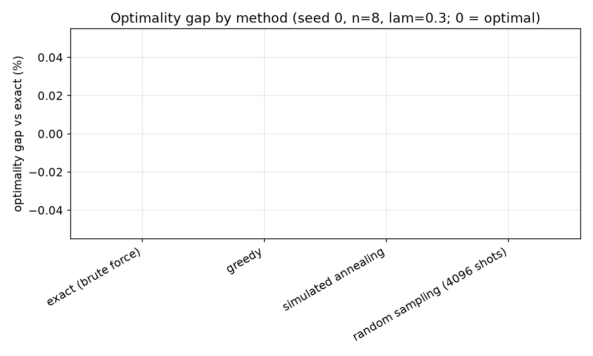

# Results

Generated by `scripts/make_results_md.py` from `results/compare_main.json` and related result files. Objective is minimised (lower is better); gap % = 100*(obj-exact)/|exact|.

## Main comparison (seed 0, n=8, lam=0.3, 4096 shots)

| method | objective (min) | value (max = -obj) | gap % | runtime s | depth | P(optimum) | P(feasible, decoded) | note |
|---|---|---|---|---|---|---|---|---|
| exact (brute force) | -3.1396 | 3.1396 | 0.0000 | 0.0075 | - | - | - |  |
| greedy | -3.1396 | 3.1396 | 0.0000 | 0.0013 | - | - | - |  |
| simulated annealing | -3.1396 | 3.1396 | 0.0000 | 0.5799 | - | - | - |  |
| random sampling (4096 shots) | -3.1396 | 3.1396 | 0.0000 | - | - | 0.0029 | 0.3662 |  |

QAOA result files missing for p = [1, 2, 3, 4]; no row shown.

## Reading the results

Seed 0, n=8, lam=0.3. exact (brute force): gap 0.00%; greedy: gap 0.00%; simulated annealing: gap 0.00%; random sampling (4096 shots): gap 0.00%. No QAOA result with a feasible sample is available.

## Lambda sensitivity (seed 0)

No QAOA rows (no QAOA result files).

| lam | method | objective (min) | gap % | P(optimum) | note |
|---|---|---|---|---|---|
| 0.1000 | exact (brute force) | -3.3492 | 0.0000 | - |  |
| 0.1000 | greedy | -3.3492 | 0.0000 | - |  |
| 0.1000 | simulated annealing | -3.3492 | 0.0000 | - |  |
| 0.1000 | random sampling (4096 shots) | -3.3492 | 0.0000 | 0.0029 |  |
| 0.3000 | exact (brute force) | -3.1396 | 0.0000 | - |  |
| 0.3000 | greedy | -3.1396 | 0.0000 | - |  |
| 0.3000 | simulated annealing | -3.1396 | 0.0000 | - |  |
| 0.3000 | random sampling (4096 shots) | -3.1396 | 0.0000 | 0.0029 |  |
| 1.0000 | exact (brute force) | -2.4059 | 0.0000 | - |  |
| 1.0000 | greedy | -2.4059 | 0.0000 | - |  |
| 1.0000 | simulated annealing | -2.4059 | 0.0000 | - |  |
| 1.0000 | random sampling (4096 shots) | -2.4059 | 0.0000 | 0.0029 |  |

## Five-seed summary (lam=0.3)

| method | seeds with gap | seeds missing | mean gap % | worst gap % |
|---|---|---|---|---|
| exact (brute force) | 5 | 0 | 0.0000 | 0.0000 |
| greedy | 5 | 0 | 3.0799 | 15.3994 |
| simulated annealing | 5 | 0 | 0.0000 | 0.0000 |
| random sampling (4096 shots) | 5 | 0 | 0.0000 | 0.0000 |

## Plots

